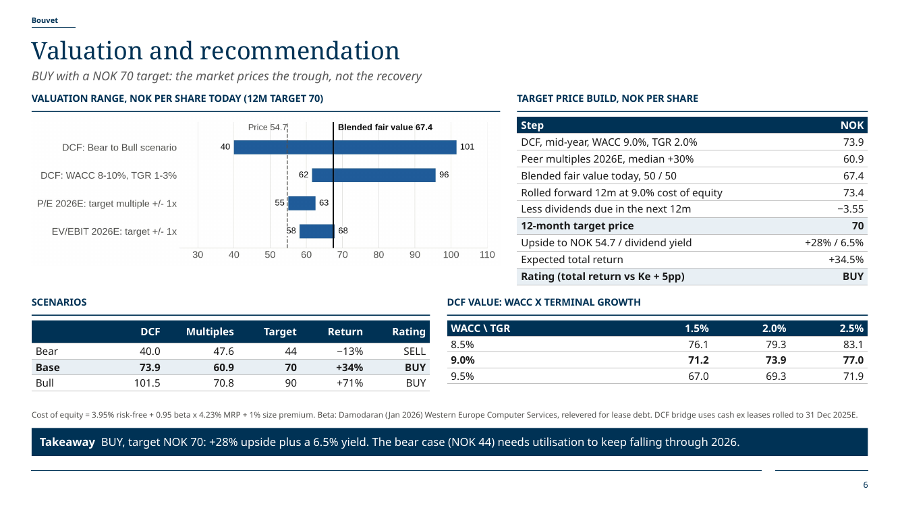

# Pareto Securities Equity Research Case 2026: Bouvet (BOUV)

**BUY** | Target price NOK 70 | Share price NOK 54.7 | Upside +28.0% | Expected total return +34.5%

Information as of 12 February 2026, the submission date. This is the revised version of our case: the original submission (HOLD, NOK 60.24) is kept under the git tag `submitted-2026-02-12`, and the changes are listed [below](#what-changed-against-the-submitted-version).

  

## Case team: Forvaltningsgruppen at TIHLDE

  

## The case

The task was a full equity analysis of **Bouvet ASA** (Oslo Børs: BOUV), a Norwegian IT consultancy, with a buy, sell or hold recommendation and a target price, delivered in a four-slide template with the Excel model attached.

| File | What it is |
| --- | --- |
| `Pareto Securities Equity research case.pdf` | The presentation as PDF, for reading without PowerPoint |
| `Pareto Securities Equity research case.pptx` | The four case slides (company, market, financials, valuation) in the official template, with native editable charts |
| `bouvet-case-2026.xlsx` | The financial model: driver-based forecast, DCF, multiples, sensitivities and integrity checks |
| `report/bouvet-research-report.pdf` | Six-page research report written in LaTeX (source in `report/`) |
| `case-information.pdf` | The case brief from Pareto Securities |

Every number in the slides and the report comes from the model.

## Thesis

1. **The 2025 slowdown was utilisation, not lost clients.** The billing ratio fell 1.6, 1.7 and 2.1 percentage points year on year in Q1 to Q3 2025, while headcount held at about 2,350 FTE and 97% of revenue still came from existing customers. Listed peers lost more revenue over the same quarters.
2. **2026 is a flat year.** Hourly price growth slowed to 2.9% in Q3'25, about the pace of realised personnel cost per FTE (2.7% in 9M'25) and below the 4.2% wage settlement. The base case holds EBITDA margin at 14.8% in 2026E (14.9% in 2025E).
3. **2027 recovers, and the market is not pricing it.** Utilisation normalises and the calendar adds two working days (253 against 251), so EBITDA margin recovers to 16.1% and EPS rises 18% to NOK 4.43. The shares trade on 14.5x our 2026E EPS, against an average of about 19x trailing over 2023 to 2025.

## Valuation

| NOK per share | Value |
| --- | --- |
| DCF (mid-year, WACC 9.0%, terminal growth 2.0%) | 73.9 |
| Peer multiples (2026E P/E and EV/EBIT, peer median +30%) | 60.9 |
| Blended fair value today (50 / 50) | 67.4 |
| 12-month target (fair value x 1.090, less 3.55 of dividends due in the next 12 months) | **70** |

| Scenario | DCF | Multiples | Target | Total return | Rating |
| --- | --- | --- | --- | --- | --- |
| Bear | 40.0 | 47.6 | 44 | -13% | SELL |
| **Base** | **73.9** | **60.9** | **70** | **+34%** | **BUY** |
| Bull | 101.5 | 70.8 | 90 | +71% | BUY |

The rating rule is anchored on required return: BUY when the expected total return is more than 5 percentage points above the cost of equity, SELL when it is more than 5 points below. The 30% peer premium is a judgement call: with no premium the target would be NOK 62 (+19.8% total return), still a BUY.

**Cost of equity 9.0%** = 3.95% risk-free + 0.95 beta x 4.23% market risk premium + 1.0% small-cap premium. The beta is Damodaran's January 2026 unlevered beta for Western European computer services (0.90, cash-corrected), relevered for Bouvet's lease debt. The market risk premium is Damodaran's January 2026 figure for Norway.

## Base case estimates

| NOKm | 2024A | 2025E | 2026E | 2027E | 2028E |
| --- | --- | --- | --- | --- | --- |
| Revenue | 3,921 | 3,934 | 4,069 | 4,352 | 4,581 |
| Growth | 11.2% | 0.3% | 3.4% | 7.0% | 5.3% |
| EBITDA | 611 | 586 | 604 | 699 | 727 |
| EBITDA margin | 15.6% | 14.9% | 14.8% | 16.1% | 15.9% |
| EBIT | 490 | 488 | 502 | 591 | 613 |
| EPS (NOK) | 3.71 | 3.64 | 3.77 | 4.43 | 4.60 |
| DPS (NOK) | 3.62 | 3.55 | 3.68 | 4.33 | 4.49 |
| Average FTE | 2,345 | 2,350 | 2,362 | 2,409 | 2,469 |
| Working days | 250 | 250 | 251 | 253 | 251 |

2025E is nine months reported plus a Q4'25 estimate.

## The model

Open `bouvet-case-2026.xlsx` in Excel 365 or LibreOffice; it recalculates on open. Inputs are blue, links to other sheets green, formulas black. Change the scenario with the selector on the Inputs sheet (1 Bear, 2 Base, 3 Bull) and the whole model follows.

| Sheet | Contents |
| --- | --- |
| Cover | Rating, target price, key estimates, model map, check status |
| Inputs | Every assumption with its source, the scenario grid and a Norwegian holiday calendar |
| Forecast | Driver-based P&L and free cash flow, 2022A to 2035E |
| WACC | CAPM cost of equity with a bottom-up beta, plus the regression-beta cross-check |
| DCF | Mid-year DCF from the valuation date with an `XNPV` cross-check and a working-day-normalised terminal year |
| Valuation | Peer multiples, blended fair value, 12-month target, rating, scenario snapshot, football field |
| Sensitivity | WACC x terminal growth and peer premium x DCF weight grids, built with `LET` and `SUMPRODUCT` |
| Checks | 13 integrity checks and a master flag; all read OK |
| Sources | APA 7 references |
| Model, FTE, Peer table, Historical multiples, Case | The data supplied with the case, with broken references cleaned up |

How the forecast works:

- **Revenue** = average FTE x working days x revenue per FTE-day. Revenue per FTE-day grows with hourly price and a utilisation effect.
- **Working days** come from `NETWORKDAYS` on a Norwegian holiday table. The table reproduces Bouvet's reported working days exactly for every year from 2021 to 2024 and for each reported quarter of 2025 (Q1 to Q3).
- **Salaries** are cost per FTE times FTE, growing with wage inflation. EBITDA margin is an output, so price versus wage growth drives it.
- **Free cash flow** treats lease payments as an operating cost. The equity bridge then adds cash excluding leases, rolled from NOK 373m at Q3'25 to NOK 435m at 31 Dec 2025E with Q4'25 cash flow less the Q4 interim dividend. The multiples use NIBD including leases, consistent with IFRS 16 EBIT.
- **Historical data** is pulled with `INDEX`/`MATCH` on the year header. Peer medians use `AGGREGATE` so error cells are ignored. The rating uses `IFS`.

## What changed against the submitted version

| Item | Submitted | Revised |
| --- | --- | --- |
| Rating and target | HOLD, NOK 60.24 | BUY, NOK 70 |
| Cost of capital | 6.06% on the WACC sheet, 7.30% hard-coded in the DCF | 9.0%, one linked value |
| Beta | Raw 0.50 | Bottom-up industry beta, relevered to 0.95 |
| Net cash | 251, 513 and 21 used in different places | Cash ex leases 373 at Q3'25, rolled to 435 at year-end (DCF); NIBD incl. leases -20.9 (multiples) |
| Shares | 102.9 and 103.8 | 103.8 |
| 2024 EBIT in the DCF | 392, a 10% margin plug | 490 reported |
| Discounting | End of year from 2024 | Mid-year from 12 Feb 2026, `XNPV` check |
| EPS forecast | 9.7% of revenue | Driver-based P&L |
| Target basis | 14x 2027E EPS | Blend of DCF and 2026E multiples, rolled forward 12 months |
| Scenarios | Growth, margin, WACC and TGR moved together (Bull +88%) | Operating drivers only; WACC fixed |
| Sensitivity and checks | None | Two sensitivity grids, 13 integrity checks |

## References

- Asness, C., Frazzini, A., Israel, R., Moskowitz, T. J., & Pedersen, L. H. (2018). Size matters, if you control your junk. *Journal of Financial Economics, 129*(3), 479-509. https://doi.org/10.1016/j.jfineco.2018.05.006
- Bhojraj, S., & Lee, C. M. C. (2002). Who is my peer? A valuation-based approach to the selection of comparable firms. *Journal of Accounting Research, 40*(2), 407-439. https://doi.org/10.1111/1475-679X.00054
- Blume, M. E. (1975). Betas and their regression tendencies. *The Journal of Finance, 30*(3), 785-795. https://doi.org/10.1111/j.1540-6261.1975.tb01850.x
- Damodaran, A. (2026a, January 5). *Country default spreads and risk premiums* [Data set]. https://pages.stern.nyu.edu/~adamodar/New_Home_Page/datafile/ctryprem.html
- Damodaran, A. (2026b, January 5). *Betas by sector, Europe* [Data set]. https://pages.stern.nyu.edu/~adamodar/pc/datasets/betaEurope.xls
- Kaplan, S. N., & Ruback, R. S. (1995). The valuation of cash flow forecasts: An empirical analysis. *The Journal of Finance, 50*(4), 1059-1093. https://doi.org/10.1111/j.1540-6261.1995.tb04050.x
- Liu, J., Nissim, D., & Thomas, J. (2002). Equity valuation using multiples. *Journal of Accounting Research, 40*(1), 135-172. https://doi.org/10.1111/1475-679X.00042

Student case work, not investment advice. Not affiliated with or endorsed by Pareto Securities or Bouvet ASA. Market sizing figures in the deck are as cited in the original submission and were not re-verified.
